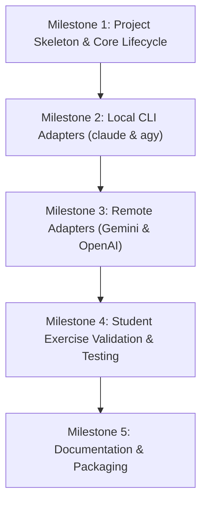

# afsar — System Design & Implementation Plan

This document details the architectural decisions, component specifications, and phased implementation plan for **afsar** based on the requirements defined in [`agent/package.md`](file:///Users/talfranji/repos/afsar/agent/package.md).

---

## 1. Project Overview & Design Philosophy

**afsar** is a lightweight, student-centric Python library that provides a uniform procedural interface to LLMs.

### Core Principles
1. **Beginner-Friendly & Procedural**: No classes or complex client lifecycles required for basic tasks. Explicit `afsar.setup()` followed by `afsar.ask()`.
2. **Zero Setup Friction (Local-First)**: If a student already has a local coding agent installed (`claude-code`, `antigravity`), `afsar` automatically discovers and uses it via CLI execution without requiring separate API keys or billing.
3. **Batteries-Included for Coding Exercises**: By default, `tools=["python", "files"]` is enabled. Local coding agents natively run Python scripts and inspect local files, enabling assignments where students write programs that generate coding questions and test-run student code.
4. **Explicit Guardrails**: Remote APIs do not yet support local execution tools out of the box; `afsar` strictly requires `tools=[]` when using remote models, giving immediate, readable errors rather than silent failures.
5. **Zero Required Dependencies**: The core package runs strictly on the Python standard library (`subprocess`, `json`, `urllib.request`, `shutil`). `pydantic` is NOT required to install or run `afsar`. Schema validation optionally leverages Pydantic if installed, or standard `@dataclass`/dict schemas without third-party dependencies.

---

## 2. Architecture & Module Structure

```
afsar/
├── pyproject.toml
├── README.md
├── agent/
│   ├── package.md          # High-level requirements
│   └── agy_design.md       # This technical design document
└── src/
    └── afsar/
        ├── __init__.py      # Public procedural API (setup, ask, exceptions)
        ├── core.py          # Session state, explicit lifecycle, engine registry
        ├── exceptions.py    # Custom exception hierarchy
        ├── types.py         # Type definitions, protocols, schema helpers
        ├── adapters/
        │   ├── __init__.py
        │   ├── base.py      # Abstract BaseAdapter interface
        │   ├── claude.py    # Claude Code CLI subprocess adapter
        │   ├── agy.py       # Antigravity CLI subprocess adapter
        │   ├── gemini.py    # Google Gemini direct REST/SDK adapter
        │   └── openai.py    # OpenAI direct REST/SDK adapter
        └── resources/
            └── afsar.png    # Library logo
```

---

## 3. Public API Specification

### 3.1 `afsar.setup()`

```python
def setup(
    model: str | None = None,
    api_key: str | None = None,
    tools: list[str] | None = ("python", "files"),
    provider: str | None = None,
) -> None:
    ...
```

#### Behavior & Rules:
1. **Explicit Requirement**: Must be called before `afsar.ask()`. If `ask()` is called prior to `setup()`, it raises `NotSetupError` ("`afsar.setup()` must be called before `afsar.ask()`").
2. **Tools Default**: Defaults to `["python", "files"]`.
3. **Auto-Detection Priority**:
   1. **`claude-code`** (`claude` executable found on system `PATH` and authenticated).
   2. **`antigravity`** (`agy` executable found on system `PATH`).
   3. **Gemini** (`GEMINI_API_KEY` present in environment or passed via `api_key`).
   4. **OpenAI** (`OPENAI_API_KEY` present in environment or passed via `api_key`).
4. **Tools Validation**:
   - If a **local agent** is detected/selected, `tools=["python", "files"]` is accepted.
   - If a **remote model** is detected/selected and `tools` is not empty (`bool(tools) is True`), `setup()` raises:
     ```
     UnsupportedFeatureError:
     Remote models do not support local code execution or file tools yet.
     To use remote models, explicitly initialize with: afsar.setup(tools=[])
     ```
5. **Overrides**: If `provider` or `model` is provided explicitly, auto-detection is bypassed in favor of that specific provider.

---

### 3.2 `afsar.ask()`

```python
def ask(
    prompt: str,
    *,
    format: str = "text",
    schema: type[Any] | None = None,
    temperature: float | None = None,
    thinking: bool | None = None,
) -> str | Any:
    ...
```

#### Parameters:
* **`prompt`** (`str`, required): The prompt text.
* **`format`** (`"text"` | `"json"`, default: `"text"`):
  * When `"text"`, returns the text answer as `str`.
  * When `"json"`, instructs the model to return valid JSON and returns the raw JSON string as `str`.
* **`schema`** (`type[Any] | None`, default: `None`):
  * If provided, `format` is ignored.
  * **Zero dependency guarantee**: `pydantic` is **not required** to install or run `afsar`.
  * If `schema` is a standard Python `@dataclass` or `dict`, `afsar` extracts the schema and validates output using the standard library.
  * If `schema` is a Pydantic model and `pydantic` is installed in the environment, `afsar` validates and returns an instantiated Pydantic instance.
  * If a student passes a Pydantic model without having `pydantic` installed, `afsar` raises a helpful `ImportError("Pydantic is required when passing a Pydantic model to schema. Run 'pip install pydantic' to enable.")`.
* **`temperature`** (`float | None`, default: `None`):
  * Temperature for generation (passed to underlying provider/CLI if supported).
* **`thinking`** (`bool | None`, default: `None`):
  * `None`: Uses model default.
  * `True`: Requests extended thinking/reasoning. If the active model does not support thinking, raises `ValueError("Model '<name>' does not support thinking.")`.
  * `False`: Disables extended thinking/reasoning if supported.

---

### 3.3 Future: `afsar.ask_full()`
Deferred to future releases. Will return a structured `AfsarResponse` dataclass containing:
* `text: str`
* `thoughts: str | None`
* `tool_calls: list[ToolCall]`
* `raw: Any`

---

## 4. Adapter Design & Execution Mechanics

All adapters inherit from `BaseAdapter`:

```python
class BaseAdapter(abc.ABC):
    name: str
    supports_tools: bool
    supports_thinking: bool
    supports_schema: bool

    @abc.abstractmethod
    def ask(
        self,
        prompt: str,
        *,
        format: str,
        schema: type[BaseModel] | None,
        temperature: float | None,
        thinking: bool | None,
    ) -> str | BaseModel:
        ...
```

### 4.1 Claude Code Adapter (`ClaudeAdapter`)
* **Detection**: Check `shutil.which("claude") is not None`.
* **Invocation**: Uses `subprocess.run()` in non-interactive print mode:
  ```bash
  claude -p "<prompt>" --output-format json --dangerously-skip-permissions
  ```
* **Flags Mapping**:
  * **Non-interactive / Print**: `-p` (`--print`).
  * **Permissions**: `--dangerously-skip-permissions` ensures automated tool execution (running student code and checking files) without blocking on an interactive TTY confirmation prompt.
  * **Tools**: When `tools` is empty (`[]`), pass `--tools ""`. When enabled, pass `--tools default`.
  * **Structured Output (`schema`)**: Pass `--json-schema '<json_string>'`.
  * **Thinking / Reasoning**:
    * `thinking=True` $\rightarrow$ `--effort high`
    * `thinking=False` $\rightarrow$ `--effort low`
  * **Model**: `--model <model>` if custom model specified in `setup()`.
* **Output Parsing**: Parse the JSON envelope emitted by `claude -p --output-format json` to extract the final result string, then validate against `schema` if requested.

### 4.2 Antigravity Adapter (`AgyAdapter`)
* **Detection**: Check `shutil.which("agy") is not None`.
* **Invocation**:
  ```bash
  agy -p "<prompt>" --output-format json --dangerously-skip-permissions
  ```
* **Flags Mapping**:
  * **Print**: `-p`.
  * **Permissions**: `--dangerously-skip-permissions`.
  * **Schema**: `--json-schema '<json_string>'`.
  * **Thinking**: `thinking=True` $\rightarrow$ `--effort high`.
* **Output Parsing**: Extract text from JSON result payload, with fallback to stdout if plain text.

### 4.3 Google Gemini Adapter (`GeminiAdapter`)
* **Detection**: `os.getenv("GEMINI_API_KEY")` is set or `api_key` supplied in `setup()`.
* **Implementation**: Uses `httpx` to call the Gemini REST API (`https://generativelanguage.googleapis.com/v1beta/models/...:generateContent`).
* **Flags Mapping**:
  * **`format="json"`**: `generationConfig.responseMimeType = "application/json"`.
  * **`schema=MyModel`**: `generationConfig.responseSchema = MyModel.model_json_schema()`.
  * **`thinking`**: Supported on `gemini-2.5-flash-thinking` / `gemini-2.0-flash-thinking`. For non-thinking models, raises `ValueError` if `thinking=True`.
* **Tools**: Rejects `tools` if non-empty during `setup()`.

### 4.4 OpenAI Adapter (`OpenAIAdapter`)
* **Detection**: `os.getenv("OPENAI_API_KEY")` is set or `api_key` supplied in `setup()`.
* **Implementation**: Uses `httpx` to call the OpenAI REST API (`https://api.openai.com/v1/chat/completions`).
* **Flags Mapping**:
  * **`format="json"`**: `response_format={"type": "json_object"}`.
  * **`schema=MyModel`**: `response_format={"type": "json_schema", "json_schema": {"name": ..., "schema": ...}}`.
  * **`thinking`**: Supported on reasoning models (`o1`, `o3-mini`).
* **Tools**: Rejects `tools` if non-empty during `setup()`.

---

## 5. Error Handling & Student Experience

Students should never see cryptic traceback dumps for common configuration issues. `afsar` provides dedicated, instructive exceptions:

| Condition | Raised Exception | Message Guidance |
| :--- | :--- | :--- |
| `ask()` called before `setup()` | `NotSetupError` | *"afsar is not configured. Please call `afsar.setup()` first."* |
| No agent or API key found | `ModelNotFoundError` | *"No local agent (claude-code, agy) or remote API keys (GEMINI_API_KEY, OPENAI_API_KEY) found."* |
| Remote API with default tools | `UnsupportedFeatureError` | *"Remote models do not support local tools. Run `afsar.setup(tools=[])` to use remote models."* |
| Thinking requested on unsupported model | `ValueError` | *"Thinking requested, but model '<name>' does not support reasoning/thinking mode."* |
| Subprocess execution fails | `ExecutionError` | Clear explanation of CLI failure and exit code. |

---

## 6. Implementation Plan & Milestones



### Milestone 1: Skeleton & State Management
- [ ] Configure `pyproject.toml` with `hatchling` (target: Python $\ge 3.10$) with **zero mandatory dependencies**.
- [ ] Implement `afsar/exceptions.py` (`AfsarError`, `NotSetupError`, `UnsupportedFeatureError`, etc.).
- [ ] Implement `afsar/core.py` with global `SessionState`, `setup()`, and `ask()`.
- [ ] Implement `BaseAdapter` abstract contract in `afsar/adapters/base.py`.

### Milestone 2: Local CLI Adapters (claude-code & agy)
- [ ] Implement `ClaudeAdapter` in `afsar/adapters/claude.py`:
  - Path detection & auth check (`claude --has-auth` or dry-run).
  - Non-interactive invocation (`-p`, `--output-format json`).
  - Permission bypass (`--dangerously-skip-permissions`).
  - `--tools` and `--json-schema` translation.
- [ ] Implement `AgyAdapter` in `afsar/adapters/agy.py`:
  - Path detection (`agy`).
  - Non-interactive invocation (`-p`, `--output-format json`).
  - `--json-schema` and `--effort` translation.
- [ ] Auto-detection priority logic in `setup()`.

### Milestone 3: Remote Adapters (Gemini & OpenAI)
- [ ] Implement `GeminiAdapter` in `afsar/adapters/gemini.py` via Python standard library `urllib.request` (zero dependencies).
- [ ] Implement `OpenAIAdapter` in `afsar/adapters/openai.py` via Python standard library `urllib.request` (zero dependencies).
- [ ] Enforce `tools=[]` guardrail when selecting remote adapters.
- [ ] Structured output mapping for `@dataclass`, `dict`, and optional `pydantic.BaseModel`.

### Milestone 4: Verification & Automated Tests
- [ ] Unit tests for `setup()` lifecycle and explicit initialization checks.
- [ ] Mock tests for CLI subprocess execution (`claude`, `agy`).
- [ ] Verification script replicating the student exercise:
  * Prompt agent to produce a Python exercise.
  * Agent writes/runs test code and validates result.
- [ ] Verification of `format="text"`, `format="json"`, and `schema=MyModel`.

### Milestone 5: Documentation & Distribution
- [ ] Complete `README.md` with beginner-friendly examples.
- [ ] Verify clean `pip install -e .` and build wheels (`python -m build`).

---

## 7. Future Considerations: Mini-Harness for Remote APIs & GitHub Copilot

* **Mini-Harness Execution Engine**: In future versions, `afsar` may incorporate a lightweight internal execution loop (ReAct / tool runner). This will enable local Python execution and file tools for:
  * Remote models (OpenAI, Gemini).
  * GitHub Copilot Chat API.
* **Current Focus**: v0.1 focuses on the zero-friction student path using local coding agents (`claude-code`, `antigravity`), which provide battle-tested, autonomous tool execution out of the box without requiring custom sandbox security or tool loop maintenance.

